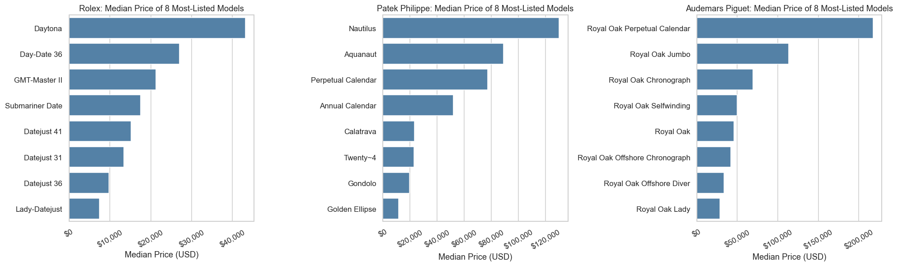
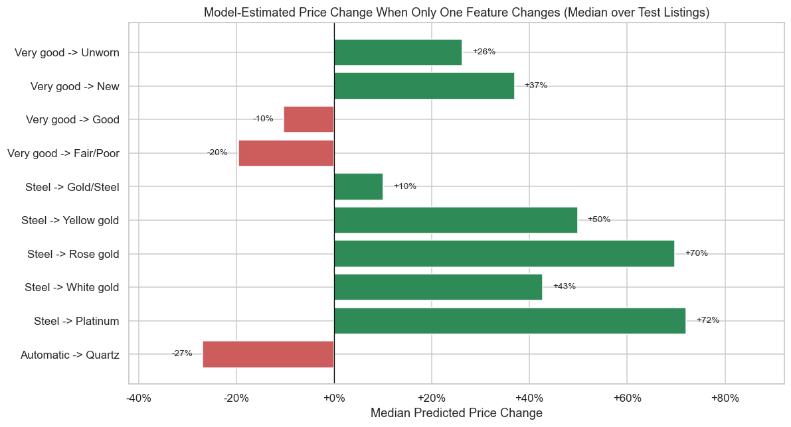
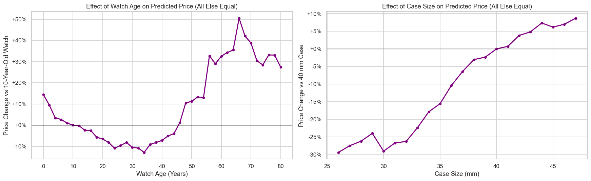
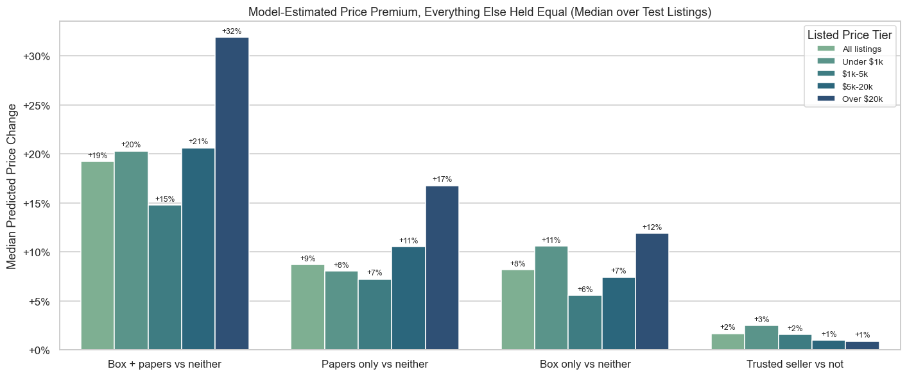
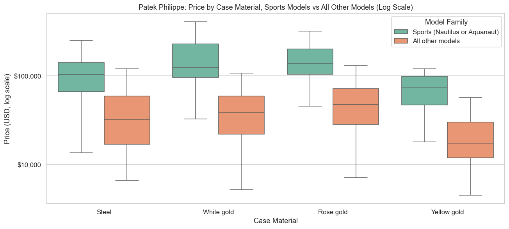
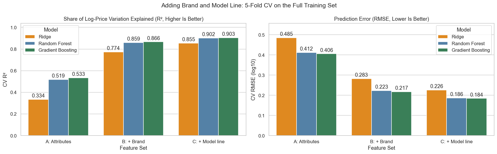
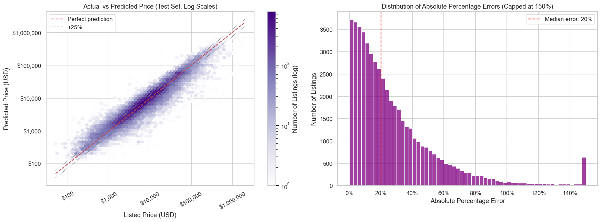

### Luxury Watch Resale Price Analysis: What Makes a Pre-Owned Watch Valuable?

**Mina Andrawos**

#### Executive summary
Luxury watches are bought both as a passion and as an alternative investment, and many are later resold, including on online marketplaces. This project looks at **more than 300,000 resale listings** (asking prices: both datasets seem to be  marketplace listings with no record of whether a watch sold or for how much) to find out **which features make a pre-owned watch more or less valuable**, and relies on data science to figure out reasonable estimates of prices.

**Key findings**
- **Brand is very important, however the exact model matters as well.** Within a single brand, one model can be listed at more than 10 times the price of another (for example, a Patek Philippe Nautilus vs a Patek Philippe Golden Ellipse). Knowing the model makes price estimates clearly better than knowing the brand alone.
- **The price estimates are much more accurate than in the first version of this project.** About half of the estimates are now within 20% of the asking price (within 37% in the first version), and almost 6 in 10 are within 25%.
- **What features are worth**, for the same watch with everything else unchanged (estimates from the data):
  - **Condition:** a *new* watch is listed for about **37% more** than one in *very good* used condition; a watch in *fair/poor* condition for about **20% less**.
  - **Case material:** gold and platinum versions of the same model are listed **43% to 72% higher** than steel ones (two-tone gold and steel: about 10% higher).
  - **Movement:** a battery-powered (quartz) version is listed about **27% lower** than a self-winding mechanical (automatic) version.
  - **Box and papers:** having the original box and papers adds about **19%**, and about **32% for watches over USD 20,000**.
- **Age is not a straight line.** Newer watches are listed higher, watches about 24-34 years old are valued lowest, and vintage pieces about 56-70 years old are valued 30-50% higher than 10-year-old ones.
- **Some "obvious" patterns are misleading.** Steel Patek Philippe watches looked more expensive than gold ones, but that is mostly because 76% of the steel ones are the very popular Nautilus and Aquanaut models. For the same model family, white and rose gold are listed higher than steel. Similarly, a "trusted seller" badge looked like it added 16% to prices, but the badge almost always belongs to the same sellers, so the data cannot separate the value of the badge from the sellers themselves.

#### Rationale
In the data used here, pre-owned watch asking prices range from USD 50 to over USD 2 million, and two watches from the same brand can differ in price by a factor of ten or more. Buyers risk overpaying, sellers risk underpricing, and resale platforms benefit from reliable price guidance. Knowing which features actually drive value, and by how much, helps:
- **buyers and collectors** judge whether an asking price is fair,
- **sellers** decide what is worth keeping or restoring (for example, the original box and papers),
- **platforms** suggest fair prices and flag listings that look mispriced.

#### Research Question
*Which combination of features (brand, model, case material, movement, condition, box and papers, age) most affects the resale price of a luxury watch, and how accurately can the price be estimated from them?*

#### Data Sources
Two public datasets of watch listings from Kaggle (a public data-sharing website), stored in [`data/`](data/):
1. **Luxury Watch Listings** ([Kaggle](https://www.kaggle.com/datasets/philmorekoung11/luxury-watch-listings)): about 285,000 listings, almost all from 20 major brands. It includes the **model name**, materials, movement, condition, year of production and case size. After cleaning: **260,648 listings**. This is the main dataset.
2. **Watch Market Dataset** ([Kaggle](https://www.kaggle.com/datasets/beridzeg45/watch-prices-dataset)): about 45,000 listings from 479 brands. It has no model names, but it records whether the watch comes with its **original box and papers**, and **information about the seller**. After cleaning: **42,214 listings**.

The prices are sellers' asking prices, not final sale prices. The author of Dataset 1 describes its prices as list prices. Dataset 2 doesn't say, but its fields describe items currently for sale (for example, "Item is in stock" and the seller's "active listings"), and neither dataset records whether or when a watch actually sold.

The two datasets agree closely: the brands rank in almost the same order by typical price in both.

#### Methodology
1. **Cleaning the data:** turned prices written as text (such as "$43,500") into numbers, removed listings marked *"Price on request"*, removed about 9,500 duplicate listings, and treated physically impossible values (such as a production year before 1900) as missing. Very expensive watches were kept on purpose: they are a real part of the luxury market, not errors.
2. **Creating useful information:** combined brand and model into one "model line" (such as *Patek Philippe Nautilus*), searched listing titles and model names for special features (for example, a stopwatch function, called a chronograph, or a tourbillon), and calculated each watch's age and case size.
3. **Fair comparisons:** to avoid misleading results, features were compared **within the same brand** (for example, gold Rolex watches vs steel Rolex watches, not gold watches vs steel watches in general), and checked with standard statistical tests.
4. **Building the price estimator:** five different methods were tried, from a simple one that always guesses the average price, to more flexible methods that learn complex patterns. Each was tested on listings it had not seen while learning. **One fifth of the listings were kept aside until the very end** for a final, independent check.
5. **Measuring what features are worth:** the final estimator was asked "what-if" questions: estimate the price of the same watch twice, changing only one detail (for example, steel vs gold), and compare.

The full details are in the [Technical summary](#bonus-technical-summary) below and in the four notebooks.

#### Results

**1. Brand gets you most of the way, the model does the rest.**
Using only a watch's physical details (materials, movement, condition, size, age and special features), the estimator explains about **half** of the differences in price between watches. Adding the brand raises this to **87%**, and adding the model to **90%**.

Within the same brand, prices vary enormously by model:



**2. How accurate are the price predictions produced in the project?**
On about 52,000 listings kept aside for the final check:
- about **half** of the estimates are within **20%** of the asking price (within 37% in the first version of this project),
- almost **6 in 10** are within **25%**,
- more than **8 in 10** are within **50%**.

The estimates are most accurate for mid-priced watches. They tend to be **too low for the most expensive watches** (the most expensive fifth are typically listed about 19% above their estimate) and too high for the cheapest ones. Accuracy also varies by brand: half of the estimates are within 14% for Tudor and 16% for Rolex, but only within 31% for Seiko. One possible reason is that about a third of Seiko listings do not name a specific model, and brands with more such listings tend to have larger errors.

**3. What specific features are worth (same watch, everything else unchanged).**



- **Condition:** *New* +37% and *Unworn* +26% compared with *Very good*; *Good* -10%; *Fair/Poor* -20%.
- **Case material:** two-tone gold and steel +10%, white gold +43%, yellow gold +50%, rose gold +70%, platinum +72% compared with steel (only for models made in both materials).
- **Movement:** battery-powered (quartz) -27% compared with self-winding mechanical (automatic).

**4. Age and size: not straight lines.**



Newer watches are listed higher. Value is lowest for watches about 24-34 years old (8-13% below a 10-year-old watch), and vintage pieces about 56-70 years old are valued 30-50% higher than 10-year-old ones (fewer listings are this old, so this part is less certain). Larger cases are worth more, mostly between 32 and 40 mm: a 28 mm case is valued about 26% lower than a 40 mm one, while a 46 mm case is only about 7% higher.

**5. Box and papers add about a fifth to the price.**



From the second dataset: a complete set (original box and papers) adds about **19%** to the price of the same watch. The effect is largest for watches above USD 20,000 (about **32%**) and smallest for USD 1,000-5,000 watches (about 15%). Papers alone or a box alone add only about 8-9% each. The value of the trusted-seller badge could not be measured reliably: the badge almost always belongs to the same sellers, so its effect cannot be separated from who the seller is (the +2% in the chart should not be read as the badge's value).

**6. The Patek Philippe "steel premium" was a model-mix effect.**

*(A "model-mix effect" means the comparison is distorted because one group contains many more of the expensive models than the other.)*



The first version of this project found steel Patek Philippe watches listed above gold ones. With model names, the explanation is clear: 76% of steel Pateks are Nautilus or Aquanaut sports models, which are expensive in every metal (typical price above USD 70,000). **For the same model family, white and rose gold are listed higher than steel**, and this difference is very unlikely to be due to chance. Yellow gold remains the cheapest in both families, possibly because yellow-gold Pateks are typically older (typical production year 1992, against 2017-2019 for the other metals).

**Recommendations**
- **Sellers:** keep the original **box and papers**; complete sets are listed about 19% higher than comparable watches without them, and about a third higher above USD 20,000. Watches in *new* condition are listed about 37% higher than comparable ones in *very good* used condition.
- **Buyers:** compare prices **within the same model, material and condition**, not just within a brand. A price far below what you'd expect is a reason to look closely at the listing, not proof of a bargain: listings priced far below their estimate are much more often missing key details (46% do not name a specific model, against 12% of all listings).
- **Resale platforms:** require sellers to fill in the **model, case material and production year**. Listings with missing details make up a large share of the biggest pricing errors (57% of listings whose estimate is off by more than 150% do not name a specific model, against 12% overall). The estimator built in this project could power a "fair price" indicator or flag listings for review.

**Limitations:** the prices are *asking* prices, not final sale prices; the "what features are worth" figures describe patterns in the data, not proof of cause and effect; and the listings have no dates, so they do not show how prices change over time.

#### Next steps
- **Use actual sale prices** (for example, auction results) instead of asking prices, and collect listings over time to study price trends and investment returns.
- **Use reference numbers** (the manufacturer's code for each exact version of a watch, such as 126610LN) for an even more precise description than the model name, and add dial details such as colour and special editions.
- **Collect box and papers and seller information for the main dataset**, so all value drivers can be measured together. A unique seller ID would also make it possible to measure seller effects reliably.
- **Give a price range instead of a single number**, so a buyer knows how confident the estimate is for a given watch.
- **Improve accuracy for the most expensive watches** with more high-end data or a separate estimator for that segment.

#### (Bonus) Technical summary
*This section is for readers with a data science background.*

- **Target:** log10(price), because price is extremely right-skewed (skewness 13.3); errors on the log scale are relative.
- **Evaluation metric:** RMSE on log10 price (primary; penalizes large relative mispricings). Supporting metrics: R² on log price, median absolute percentage error (MdAPE) and the share of predictions within ±25%.
- **Validation:** 80/20 train/test split; 5-fold cross-validated grid search for every model on a 40,000-listing tuning sample, then 5-fold cross-validation of the tuned Ridge, Random Forest and Gradient Boosting models on the full 208,000-listing training set, which was used to select the final model. The test set was used once.
- **Feature sets** (Gradient Boosting, 5-fold CV on the full training set):

| Information used | CV R² (log price) | CV RMSE (log10) |
|---|---|---|
| Attributes only | 0.533 | 0.406 |
| + Brand | 0.866 | 0.217 |
| + Model line | **0.903** | **0.184** |



- **Test-set results** (Dataset 1, 52,130 listings):

| Model | R² (log price) | Median % error | Within ±25% |
|---|---|---|---|
| Dummy (always predicts the mean) | 0.00 | 70% | 17.0% |
| Ridge | 0.86 | 26% | 48.0% |
| Random Forest | 0.90 | 20% | 59.2% |
| **Gradient Boosting (final model)** | **0.90** | **20%** | **58.5%** |
| *Initial report: Ridge baseline on Dataset 2* | *0.80* | *37%* | *-* |



- **Like-for-like comparison on Dataset 2:** the initial Ridge baseline re-run on the same split reaches R² 0.81 and an MdAPE of 38.6%; tuned Gradient Boosting with the extended features reaches R² 0.88 and 28.9%.
- **Interpretation:** permutation importance, partial dependence (age, case size) and "what-if" predictions that change one feature at a time. Within-brand comparisons were tested with Wilcoxon signed-rank, Mann-Whitney U and Kruskal-Wallis tests.

#### Outline of project
- [Notebook 1: Data cleaning, feature engineering and exploratory analysis](01_data_cleaning_and_eda.ipynb)
- [Notebook 2: Model training and tuning (grid search, cross-validation, model selection)](02_model_training_and_tuning.ipynb)
- [Notebook 3: Model evaluation and insights (errors, feature importance, what-if premiums)](03_model_evaluation_and_insights.ipynb)
- [Notebook 4: Box, papers and seller analysis (Dataset 2)](04_box_papers_and_seller_analysis.ipynb)

**Project structure**
```
├── README.md
├── 01_data_cleaning_and_eda.ipynb
├── 02_model_training_and_tuning.ipynb
├── 03_model_evaluation_and_insights.ipynb
├── 04_box_papers_and_seller_analysis.ipynb
├── data/
│   ├── Watches-ds-1.csv                 # raw Dataset 1
│   ├── watches-ds-2.csv                 # raw Dataset 2
│   └── processed/                       # cleaned data written by Notebook 1
├── images/                              # figures used in this README (written by the notebooks)
└── models/                              # selected model, settings and test results (written by Notebook 2)
```
**To reproduce:** run the notebooks in order (1 to 4). Requires Python 3 with pandas, NumPy, scikit-learn (1.4 or newer), Matplotlib, seaborn, SciPy, pyarrow, joblib and threadpoolctl. On my laptop, Notebook 2 takes about 15 minutes, Notebook 4 about 1 minute, and Notebooks 1 and 3 about 10 and 30 seconds.

##### Contact and Further Information
Mina Andrawos. The initial version of this project (exploratory analysis and Ridge baseline) is available [here](https://github.com/minaandrawos/berkeley-ai-ml-certificate/tree/main/capstone-initial).
